

  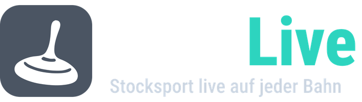

<h3 align="center">Anzeige, Eingabe und Wertung fürs Eisstockschießen</h3>

  <a href="https://reinhardgruber.github.io/MoarLive/"><b>🌐 Webseite</b></a> ·
  <a href="#-demo"><b>▶️ Demo</b></a> ·
  <a href="https://github.com/ReinhardGruber/MoarLive/issues/new?title=Anfrage%20MoarLive"><b>✉️ Anfrage</b></a>

---

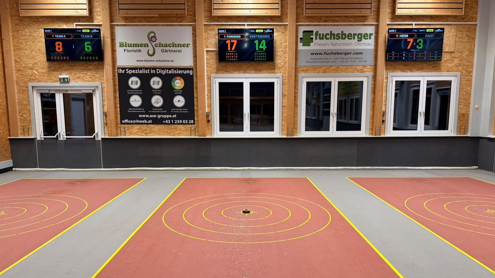

<i>MoarLive im Einsatz: Live-Anzeigen über jeder Bahn beim ESV Wolfsbach</i>

**MoarLive** ist das Wertungssystem für den Stocksport. Jede Kehre wird mit einem Dreh oder Tastendruck eingegeben und erscheint sofort groß auf dem Fernseher an der Bahn, in der ganzen Halle und am Handy. Training, Spiel, Cup und ganze Turniere – alles in einem Programm.

✅ Im Einsatz beim **ESV Wolfsbach**

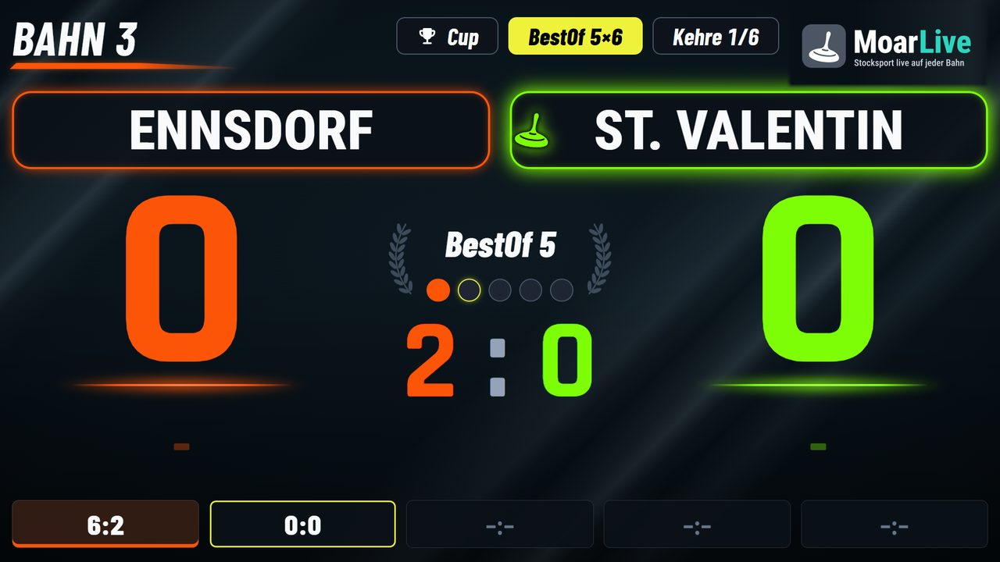

## Was ist MoarLive?

Beim Eisstockschießen wird nach jeder Kehre gezählt. Mit MoarLive muss niemand mehr auf Zettel schreiben oder Tafeln umstecken: Der Spielstand wird eingegeben und alle sehen ihn sofort.

- 📺 Spielstand, Kehren und Ergebnis groß auf jedem Fernseher
- 🎛️ Eingabe per Drehknopf, TV-Fernbedienung, Handy oder PC
- 🏆 Turniere mit Spielplan, Live-Tabelle und fertigen Drucken
- 💶 Werbung und Sponsorenlogos zwischen den Spielen
- 🏟️ Mehrere Vereine auf einem System, jeder mit eigenem Bereich und eigenem Design

## Vorteile

| | |
|---|---|
| **Jeder Fernseher wird zur Anzeigetafel** | Fire TV Stick am Fernseher oder Fernseher mit Fire TV genügt. Die Anzeige startet beim Einschalten von selbst. |
| **Eingabe in Sekunden** | Drehen, drücken, fertig. Fehler lassen sich zurücknehmen. |
| **Turniere ohne Rechenbüro-Stress** | Spielplan, Bahnverteilung, Tabelle nach IER und Drucke kommen automatisch. |
| **Mehrere Vereine, ein System** | Eigene Bahnen, Geräte, Benutzer und Vereinsfarben je Verein. |
| **Werbung für Sponsoren** | Logos und Werbebilder auf freien Bahnen und im Sponsorenband. |
| **TV-Design individuell anpassbar** | Farben, Schriften, Logo und Hintergrund im Vereinsstil, mit Live-Vorschau. |
| **Immer aktuell** | Updates kommen automatisch, auch auf die Drehknöpfe. |

## Anzeigen

| Hallenanzeige | Spiele im Überblick |
|---|---|
| 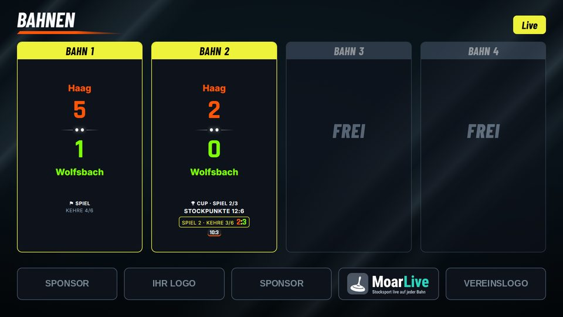 | 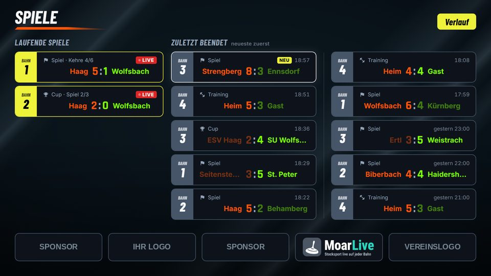 |
| **Training** | **Bahn frei mit Werbung** |
| 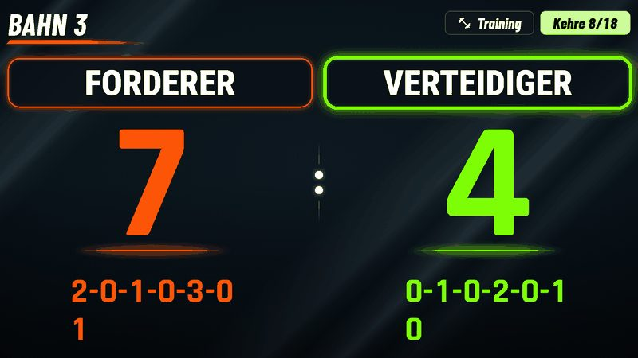 | 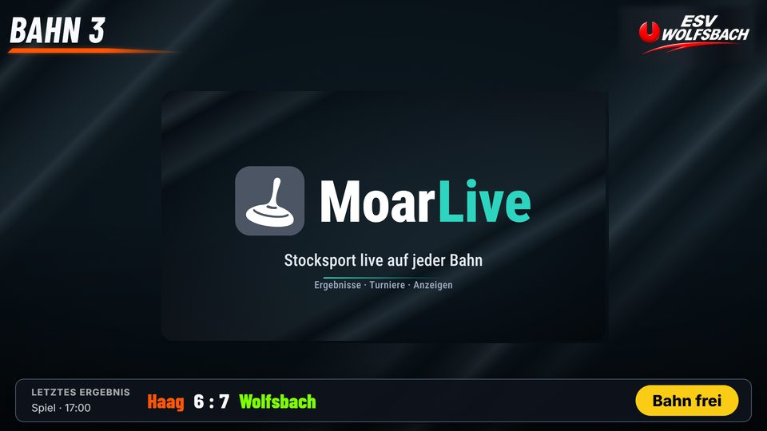 |

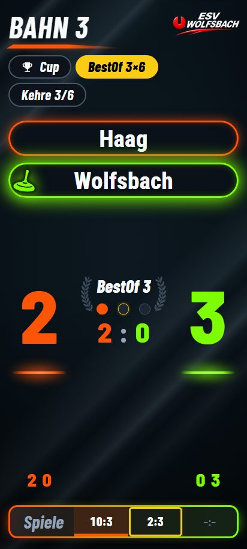 <b>Am Handy</b>

## 🎨 TV-Design individuell anpassbar

Die Anzeigen sehen aus wie Ihr Verein: eigene Farben, Schriften, Vereinslogo und Hintergrund. Fertige Vorlagen zum Starten, Live-Vorschau beim Gestalten, Design als Datei exportieren und übernehmen.

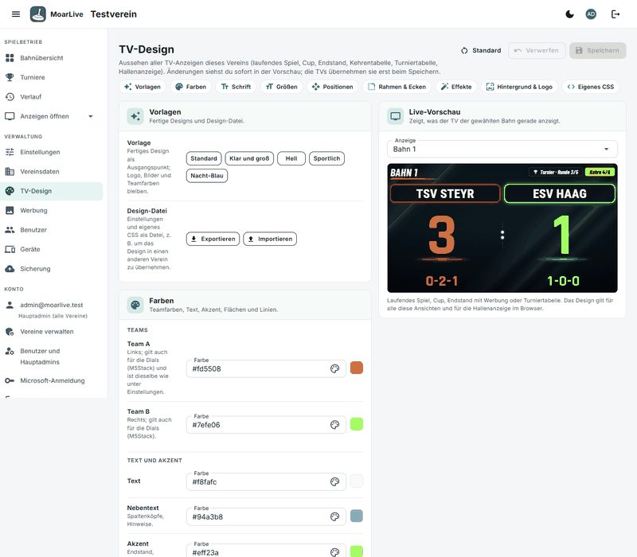

## Eingabemöglichkeiten

### 🎛️ Der MoarLive-Drehknopf: Twist & Push

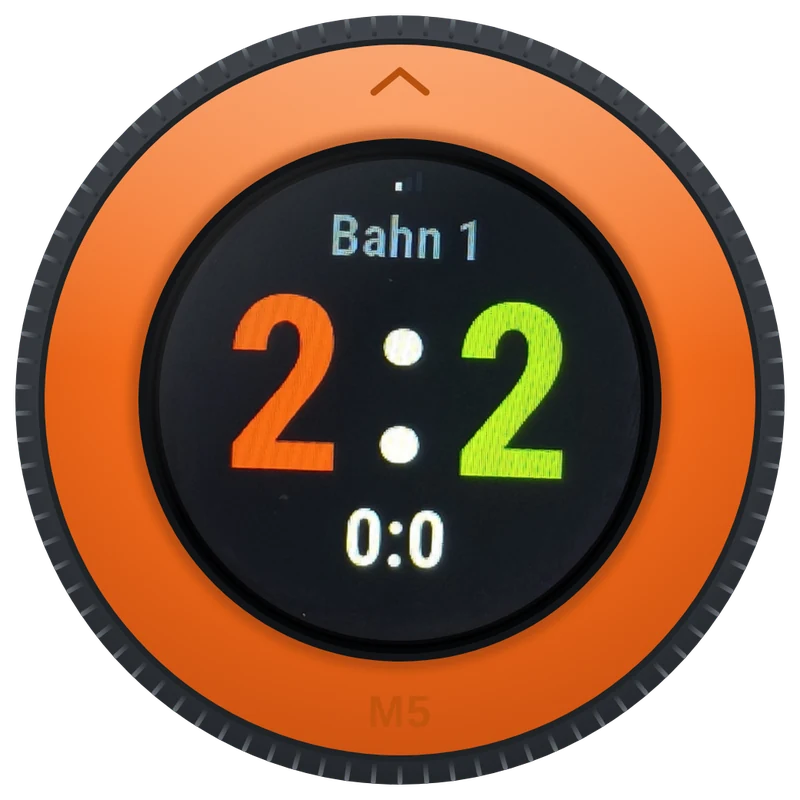

| **Schritt 1** | **Schritt 2** | **Schritt 3** | **Schritt 4** |
|:---:|:---:|:---:|:---:|
| 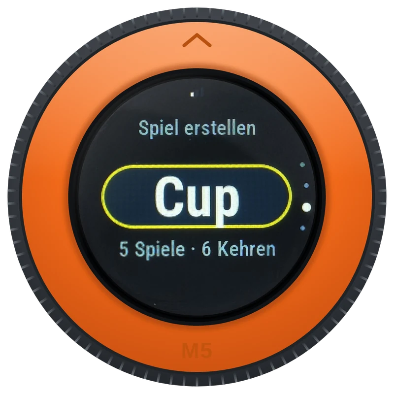 | 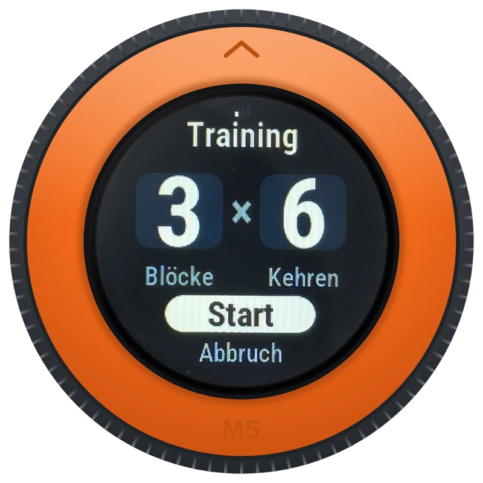 | 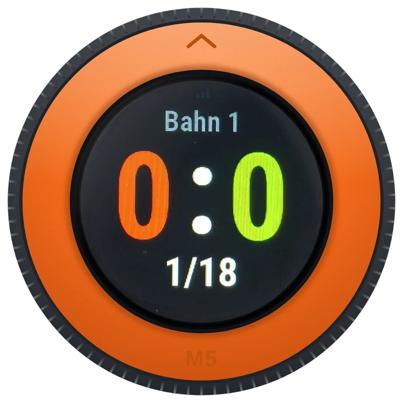 | 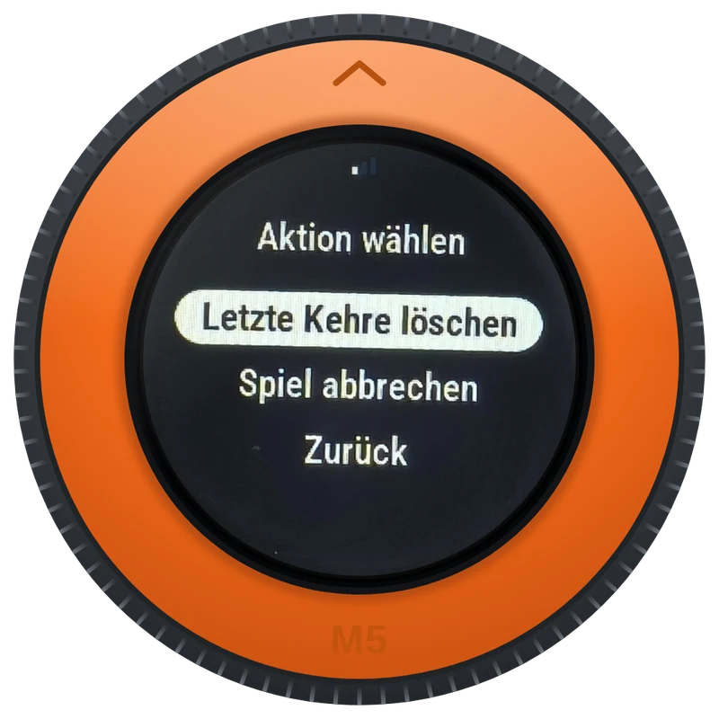 |
| Spielart wählen | Training starten | Punkte eintragen | Bei Bedarf korrigieren |

- **Drehen** wählt Team und Punkte, **Drücken** sendet
- **Keine Leitung zur Anzeige nötig:** Der Knopf funkt über WLAN
- **Läuft mit Akku oder USB-C-Netzteil**
- Updates kommen automatisch über WLAN

### Oder ganz ohne Zusatzgerät

| Fernbedienung am TV | Handy, Tablet, PC |
|---|---|
| 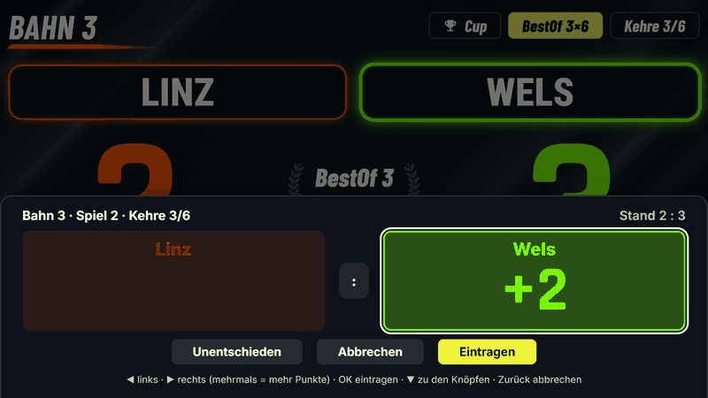 | 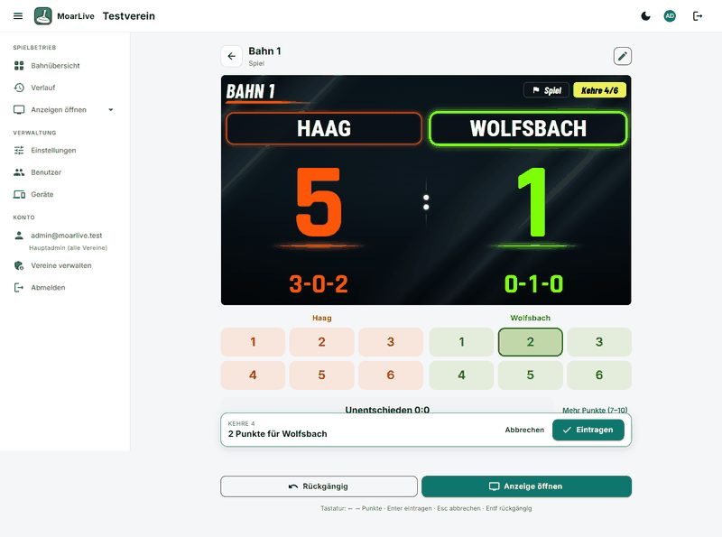 |
| Punkte eintragen und Spiele starten mit der Fire-TV-Fernbedienung. | Im Browser anmelden und Punkte antippen. |

## Turniermodus

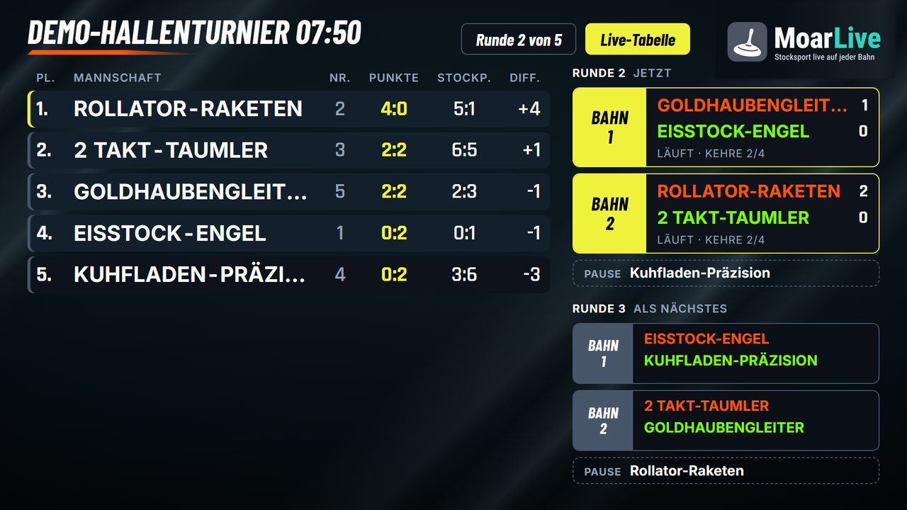

- Spielplan „Jeder gegen Jeden“ wird automatisch erstellt
- Gleichmäßige Verteilung auf die Bahnen, ausgeglichenes Anspiel
- Live-Tabelle in der Halle: wer spielt jetzt, wer als Nächstes, wer hat Pause
- Wertung nach IER: Punkte, Stockpunkte-Differenz, direkter Vergleich
- Drucke: Ergebnisliste, Wertungs- und Laufkarten, Mannschaftsblatt, Zahlungsbestätigung
- Folgeturnier mit Aufsteigern, Turnier kopieren

Dazu die Spielarten **Training**, **Spiel** und **Cup**.

**Verwaltung: Bahnübersicht**

Alle Bahnen und Hallenanzeigen mit Live-Vorschau. Punkte eintragen oder Training, Spiel und Cup mit einem Klick starten.

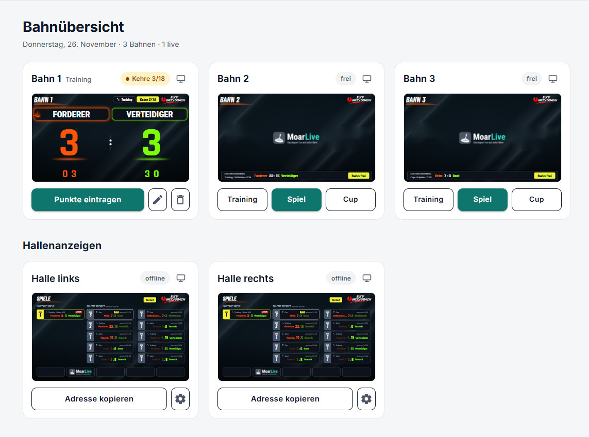

## Installation

> 📺 **Für jede Anzeige nötig:** ein Fernseher mit Fire TV oder ein Fire TV Stick am Fernseher.
>
> **Kein Server pro Bahn!** Beim gehosteten Server brauchen Sie gar keinen eigenen Rechner. Nur bei der lokalen Installation steht **ein einziger** Rechner im Vereinsheim, für alle Bahnen zusammen: ein vorhandener PC mit Windows oder Linux, ein Mini-PC oder ein Raspberry Pi.

| ☁️ Gehosteter Server | 🏠 Lokaler Server |
|---|---|
| MoarLive läuft bei uns in der Microsoft Azure Cloud. Ihr Verein bekommt einen eigenen Bereich. | MoarLive läuft auf einem einzigen Rechner im Vereinsheim (PC, Mini-PC oder Raspberry Pi). |
| **Kein eigener Rechner oder Server nötig** | **Nur ein Rechner für die ganze Halle** |
| Nichts zu installieren und zu warten | Funktioniert auch ganz ohne Internet |
| Updates und Sicherung übernehmen wir | Alle Daten bleiben im Verein |
| Ergebnisse auch von daheim abrufbar | Aktualisiert sich nachts automatisch |
| Voraussetzung: WLAN mit Internet in der Halle | Wir helfen bei der Einrichtung |

**In vier Schritten zur Anzeige:** Verein anlegen → Fernseher mit Fire TV anschließen (App MoarLive TV) → Gerät mit dem angezeigten Code freischalten → spielen.

### So hängt alles zusammen

| ☁️ Gehostet (Microsoft Azure Cloud) | 🏠 Lokal (ein Rechner in der Halle) |
|:---:|:---:|
| 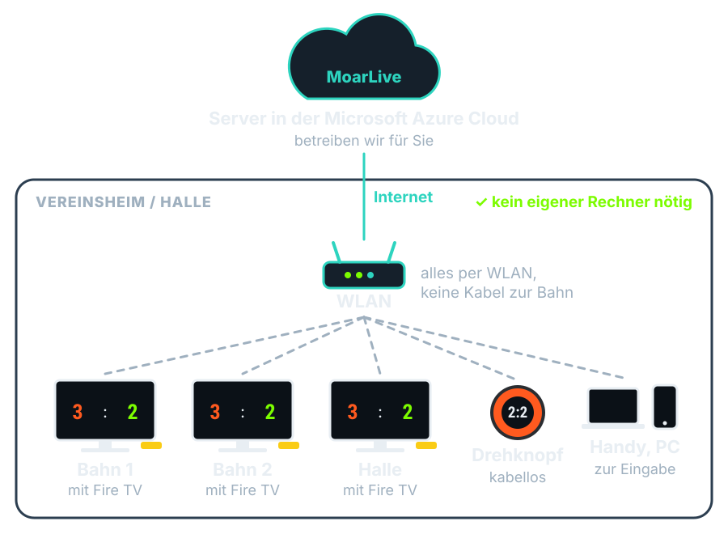 | 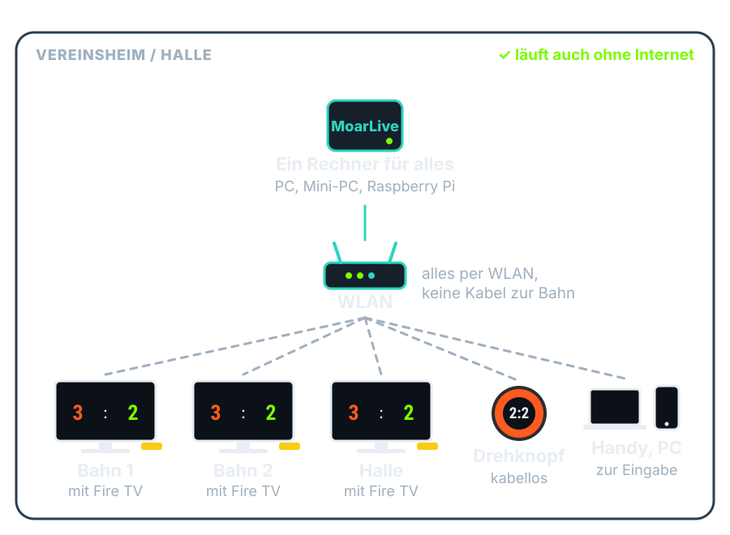 |

## 💶 Preise

**★ Einführungspreis bis 31.03.2027.** Alle Funktionen sind immer dabei, Sie zahlen nur für Ihre Bahnen.

| | ☁️ Gehostet | 🏠 Lokal |
|---|---|---|
| Je Bahn und Monat | ~~5 €~~ **3 €** | ~~5 €~~ **3 €** |
| Server pro Monat | ~~15 €~~ **10 €** | entfällt (Rechner stellt der Verein) |
| Einrichtung aus der Ferne | – | auf Wunsch einmalig 49 € |

**Pakete (Einführungspreise bis 31.03.2027, pro Monat):**

| Paket | Gehostet | Lokal |
|---|---|---|
| Start, bis 2 Bahnen | 15 € | 5 € |
| Verein, bis 4 Bahnen | 20 € | 10 € |
| Halle, bis 6 Bahnen | 25 € | 15 € |
| Groß, bis 10 Bahnen | 35 € | 25 € |

✓ Alle Funktionen inklusive Turniermodus · ✓ Updates und Support inklusive · ✓ Jährlich: 10 Monate zahlen, 12 nutzen · ✓ 30 Tage gratis testen

📺 **Pro Anzeige brauchen Sie** einen Fernseher mit Fire TV oder einen Fire TV Stick am Fernseher. Fernseher, Fire TV und Drehknopf sind nicht im Preis enthalten. Mehr als 10 Bahnen auf Anfrage. Alle Preise in Euro, zzgl. USt.

## Im Einsatz beim ESV Wolfsbach

Beim ESV Wolfsbach läuft alles mit MoarLive: alle Bahnen, alle Anzeigen, Training, Meisterschaft und Turniere. MoarLive ist dort entstanden und wird im laufenden Spielbetrieb genutzt.

## ▶️ Demo

Im Demo-Verein laufen rund um die Uhr simulierte Spiele und Turniere. Nach einer kurzen Anfrage wird ein Zugang zu Testzwecken freigeschaltet:

**➡️ [Demo-Zugang anfragen](https://github.com/ReinhardGruber/MoarLive/issues/new?template=demo-anfrage.yml)**

Lieber persönlich? [Vorführung anfragen](https://github.com/ReinhardGruber/MoarLive/issues/new?title=Anfrage%20MoarLive)

---

Suchbegriffe: Eisstockschießen, Eisstock, Stocksport, Stockschießen, Stockschützen, Wertung, Wertungssystem, Anzeige, Anzeigetafel, Eingabe, Punkteeingabe, Turnierverwaltung.

[Impressum](https://reinhardgruber.github.io/MoarLive/impressum.html)
